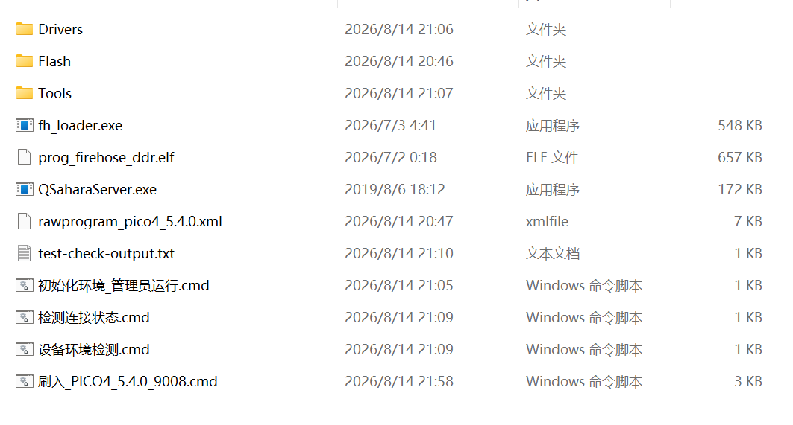

# PICO4 5.4.0 9008 Flash Pack

[**中文**](#中文) | [**English**](#english) | [**Русский**](#русский)

---

<a id="中文"></a>

## 中文

### 简介

PICO 4 变砖救砖包，基于 Qualcomm 9008 模式全量刷写。

### 使用方式

1. 下载本仓库（GitHub 轻包）
2. 下载全量包（Google Drive 链接见下方）
3. 把全量包里的 `Flash` 文件夹解压到本仓库根目录



4. 右键 `初始化环境_管理员运行.cmd` → 以管理员身份运行
5. 运行 `刷入_PICO4_5.4.0_9008.cmd`

### 资源下载

| 包 | 说明 | 链接 |
|---|---|---|
| GitHub 轻包 | 脚本 + 工具 + 驱动 | 本仓库 |
| Google Drive 全量包 | Flash 分区镜像 | 上传好慢啊……你怎么来这么快？等我睡醒再补🔗 |

这个包已经包含了9008，adb，fastboot等工具，开盖即食

### 完整包哈希值（防篡改）

下载 `Flash.7z` 后，请校验哈希值是否匹配：

**SHA-256（推荐，最可靠）**
```
DBE52759D7CA5814A6F407C41D1E6D7D08B915FCAA01A1F0193DEE54D8F8317B
```

**SHA-1**
```
112EDCD106752ADA703966A2C746A3ACF50CC686
```

**MD5**
```
EAFE5D66478CF5AC3FB6A4D59968D4E4
```

校验命令：

Windows：
```
certutil -hashfile Flash.7z SHA256
```

Mac / Linux：
```
shasum -a 256 Flash.7z
```

### 这些文件的来历

有个朋友手上有台 PICO 4 工程机，默认是 5.4.0 工程机系统。

问题：PICO 商店无法使用，PICO Connect 只能装 9.X.X 版本，且有线串流用不了，只能用无线。

于是他找 PICO 官方售后，刷了一个特殊的 **5.13.7**（不带 S，零售机是 5.13.7.S）。

结果：有线无线全挂，串流完全不能用。系统里有更新提示，他点了更新，直接卡开机——无限重启，一直显示 PICO logo。

我死马当活马医，给他刷了零售机 **5.4.0** 系统。开机成功，PICO App 可以检测到设备，PICO 商店也能正常下载应用了，PICO Connect 10.6.6 有线无线串流都正常（按理说 5.11.2 版本之后才能正常用 10.6.6，这个 5.4.0 反而可以）。

这个包就是当时救砖用的完整镜像，如果有人遇到类似情况，可以试试看。

感谢 [PhoenixPlace 论坛](https://phoenixplace.xyz/showthread.php?tid=3744) 提供的救砖思路。

### 注意事项

- 设备必须处于 **9008 深度刷机模式**（按住电源键与音量加，疯狂点击音量减键）
- 刷机前请确保电量充足，保持供电
- 此包不会写入 GPT、userdata、persist、cache、EFS/modemst、devinfo 或校准数据
- 刷完后请进入 recovery 恢复出厂设置后再开机

---

<a id="english"></a>

## English

### Introduction

PICO 4 brick recovery package. Full flash via Qualcomm 9008 mode.

### How to Use

1. Download this repo (GitHub light pack)
2. Download the full bundle (Google Drive link below)
3. Extract the `Flash` folder from the bundle into the repo root


4. Right-click `初始化环境_管理员运行.cmd` → Run as Administrator
5. Run `刷入_PICO4_5.4.0_9008.cmd`

### Downloads

| Package | Description | Link |
|---|---|---|
| GitHub light pack | Scripts + tools + drivers | This repo |
| Google Drive full bundle | Flash partition images | Still uploading... how did you get here so fast? 😴 Link after I wake up. |

This package includes 9008 tools, adb, fastboot and everything needed — ready to use out of the box.

### Full Bundle Hashes (Integrity Check)

Verify the hash of `Flash.7z` after downloading:

**SHA-256 (recommended)**
```
DBE52759D7CA5814A6F407C41D1E6D7D08B915FCAA01A1F0193DEE54D8F8317B
```

**SHA-1**
```
112EDCD106752ADA703966A2C746A3ACF50CC686
```

**MD5**
```
EAFE5D66478CF5AC3FB6A4D59968D4E4
```

Verification commands:

Windows:
```
certutil -hashfile Flash.7z SHA256
```

Mac / Linux:
```
shasum -a 256 Flash.7z
```

### Background Story

A friend had a PICO 4 engineering unit. It shipped with 5.4.0 engineering firmware.

Problems: PICO Store was unusable. PICO Connect only worked with 9.X.X versions, and only wireless streaming — wired was broken.

He contacted PICO official support, who flashed a special **5.13.7** build (without the "S" suffix — retail units use 5.13.7.S).

Result: Both wired and wireless streaming stopped working entirely. The system showed an OTA update notification. He clicked update, and the device was soft-bricked — infinite boot loop at the PICO logo.

I took a gamble and flashed retail **5.4.0** firmware. The device booted successfully. PICO App detected the device, PICO Store worked normally, and PICO Connect 10.6.6 streamed over both wired and wireless without issues (normally 5.11.2+ is required for 10.6.6, but 5.4.0 works fine).

This package contains the exact firmware used in that recovery. If you run into a similar situation, give it a try.

Thanks to [PhoenixPlace forum](https://phoenixplace.xyz/showthread.php?tid=3744) for the brick recovery guide.

### Notes

- Device must be in **Qualcomm 9008 mode** (hold power + volume up, rapidly tap volume down)
- Ensure sufficient battery and keep power connected before flashing
- This package does NOT write GPT, userdata, persist, cache, EFS/modemst, devinfo, or calibration data
- Enter recovery and factory reset after flashing before booting

---

<a id="русский"></a>

## Русский

### Введение

Пакет для восстановления PICO 4 из состояния «кирпич». Полная прошивка через режим Qualcomm 9008.

### Инструкция

1. Скачайте этот репозиторий (облегчённый пакет GitHub)
2. Скачайте полный пакет (ссылка на Google Drive ниже)
3. Распакуйте папку `Flash` из полного пакета в корень репозитория


4. Правой кнопкой мыши на `初始化环境_管理员运行.cmd` → Запуск от имени администратора
5. Запустите `刷入_PICO4_5.4.0_9008.cmd`

### Ссылки для скачивания

| Пакет | Описание | Ссылка |
|---|---|---|
| GitHub (облегчённый) | Скрипты + инструменты + драйверы | Этот репозиторий |
| Google Drive (полный) | Образы разделов Flash | Загружается... ты как так быстро? 😴 Проснусь — кину ссылку. |

В пакет уже включены инструменты для 9008, adb, fastboot и всё необходимое — готово к использованию.

### Хеши полного пакета (проверка целостности)

Проверьте хеш `Flash.7z` после скачивания:

**SHA-256 (рекомендуется)**
```
DBE52759D7CA5814A6F407C41D1E6D7D08B915FCAA01A1F0193DEE54D8F8317B
```

**SHA-1**
```
112EDCD106752ADA703966A2C746A3ACF50CC686
```

**MD5**
```
EAFE5D66478CF5AC3FB6A4D59968D4E4
```

Команды для проверки:

Windows:
```
certutil -hashfile Flash.7z SHA256
```

Mac / Linux:
```
shasum -a 256 Flash.7z
```

### Предыстория

У моего знакомого был инженерный образец PICO 4 с прошивкой 5.4.0.

Проблемы: PICO Store не работал, PICO Connect устанавливался только версии 9.X.X, и работала только беспроводная трансляция — проводная не функционировала.

Он обратился в официальную поддержку PICO, где ему установили специальную сборку **5.13.7** (без суффикса "S" — розничные устройства используют 5.13.7.S).

Результат: перестали работать и проводная, и беспроводная трансляция. В системе появилось уведомление об OTA-обновлении. После его установки устройство превратилось в «кирпич» — бесконечная перезагрузка с логотипом PICO.

Я решил рискнуть и прошил розничную версию **5.4.0**. Устройство успешно загрузилось. PICO App обнаружил гарнитуру, PICO Store заработал, а PICO Connect 10.6.6 стабильно работал как по проводу, так и по Wi-Fi (обычно для 10.6.6 требуется 5.11.2+, но 5.4.0 отлично справляется).

Этот пакет содержит ту самую прошивку, которая использовалась для восстановления. Если вы столкнулись с похожей ситуацией — попробуйте.

Благодарность [форуму PhoenixPlace](https://phoenixplace.xyz/showthread.php?tid=3744) за идею восстановления.

### Примечания

- Устройство должно находиться в режиме **Qualcomm 9008** (зажмите питание + громкость вверх, быстро нажимайте громкость вниз)
- Перед прошивкой убедитесь, что устройство заряжено и подключено к питанию
- Этот пакет НЕ записывает GPT, userdata, persist, cache, EFS/modemst, devinfo и калибровочные данные
- После прошивки войдите в recovery и сделайте сброс к заводским настройкам перед загрузкой